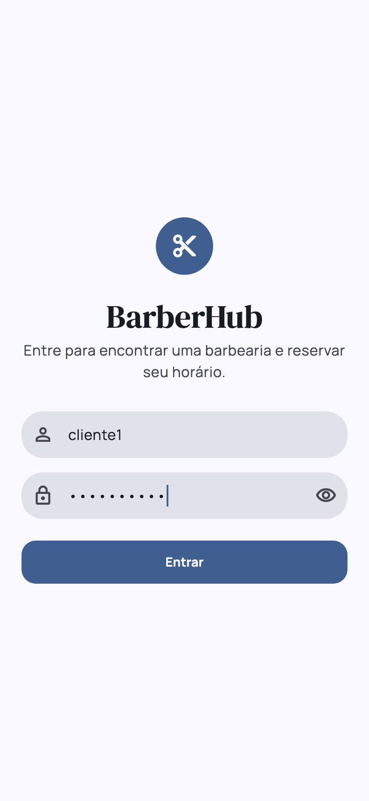
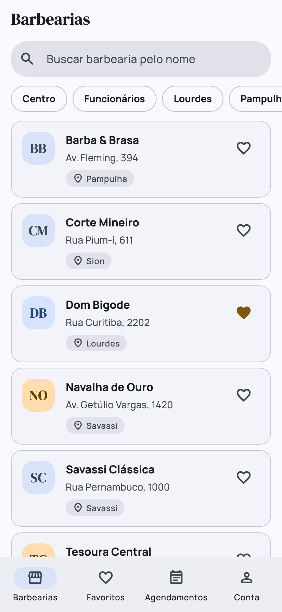
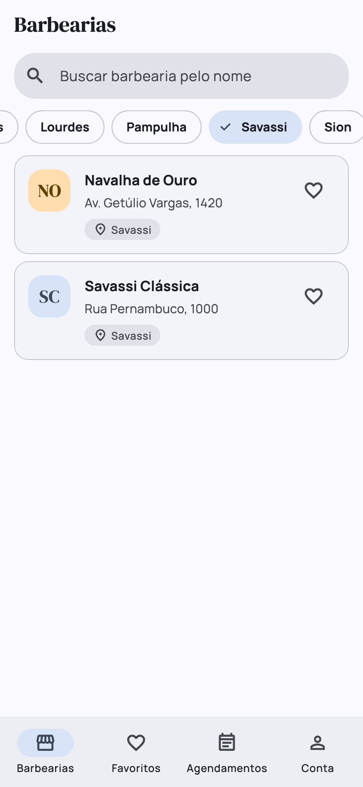
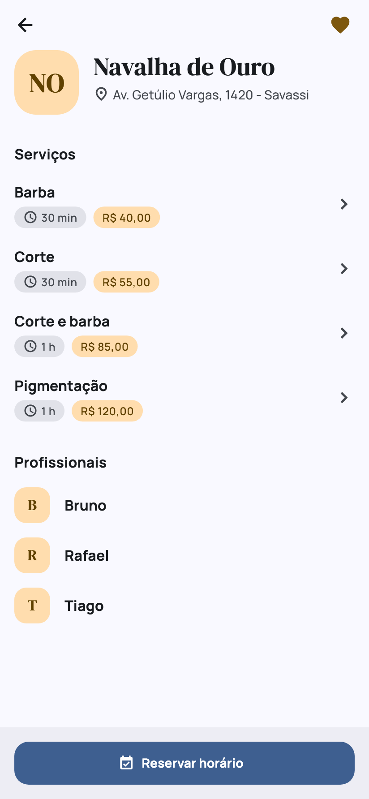
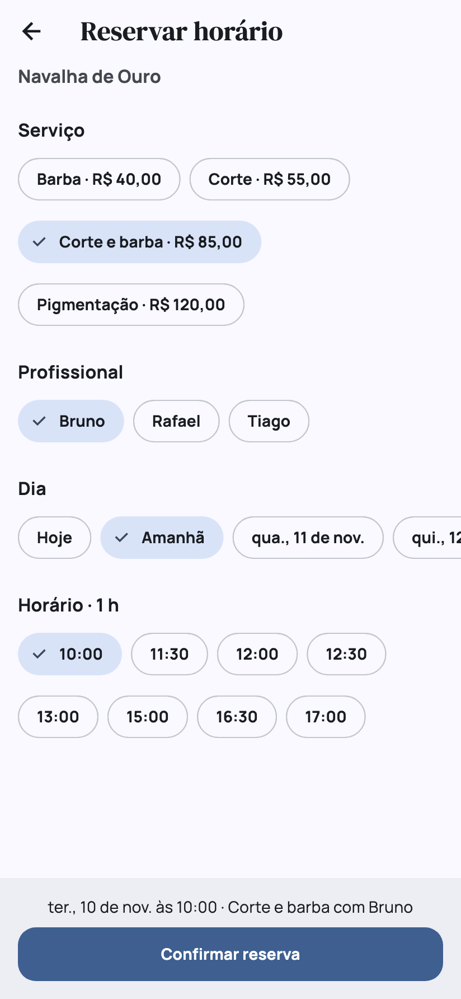
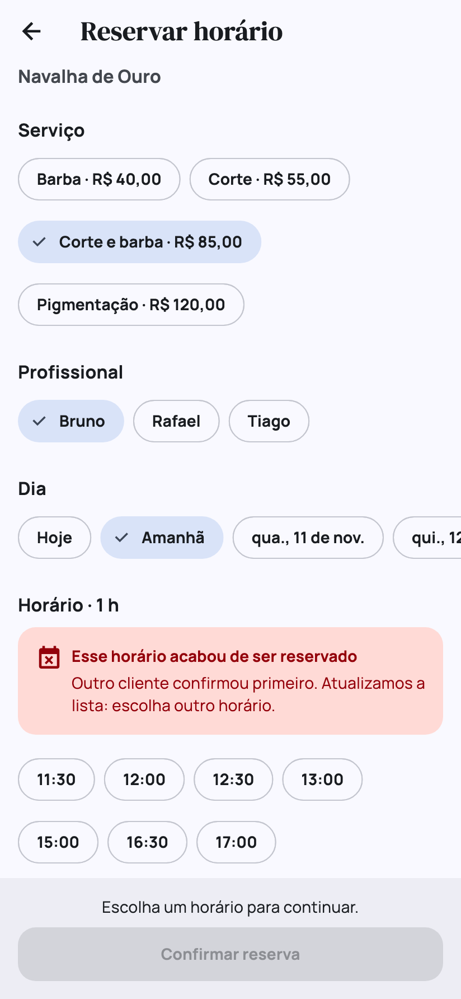
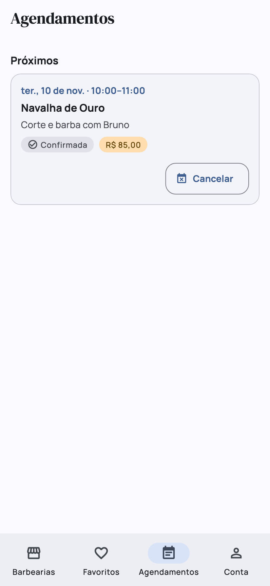
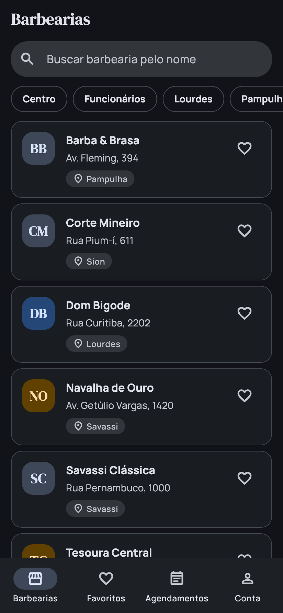
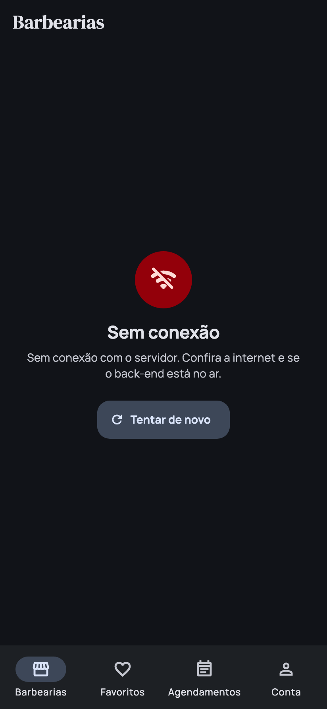

# BarberHub: app mobile (Flutter)

App de agendamento em barbearias do **Grupo 8**, feito como Projeto Final de **Arquitetura de Aplicações Móveis e Multiplataforma** (PUC Minas IEC, prof. Jackson Smith Moisés Matias). É o front do back-end deste monorepo: o app só conversa com o BFF, que valida o token do Keycloak e chama os serviços.

> **Situação (09/11/2026):** as 8 features estão implementadas, com testes. Decisões em [ADR.md](ADR.md) (framework, estado, login, favoritos no aparelho e agendamentos do servidor) e no [ADR-0016](../../docs/adr/0016-app-mobile-flutter.md) do monorepo (como o app entra na arquitetura).

## O que o app faz

O cliente entra com a conta do Keycloak, encontra uma barbearia (lista, busca por nome e filtro por bairro), vê os serviços e os profissionais, escolhe um horário livre e reserva. Se outro cliente confirmar o mesmo horário primeiro, o app explica a disputa (409) e atualiza os horários. Na aba Agendamentos, o cliente vê as próprias reservas, lidas do servidor, e pode cancelar. As barbearias favoritas ficam guardadas no aparelho.

| # | Feature | Onde fica | De onde vêm os dados |
|---|---|---|---|
| 1 | Login do cliente | tela de entrada e aba Conta | Keycloak (realm `barbearia`, client `barberhub-app`) |
| 2 | **Lista** de barbearias | aba Barbearias | `GET /barbearias` |
| 3 | **Detalhe**: serviços e profissionais | tela por cima da lista | `GET /barbearias/{id}/profissionais` e `/servicos` |
| 4 | **Busca** por nome | aba Barbearias | lista já carregada (filtra no app) |
| 5 | **Filtro** por bairro | aba Barbearias | bairro tirado do endereço |
| 6 | **Favoritos** que sobrevivem a fechar o app | coração na lista e no detalhe; aba Favoritos | armazenamento local |
| 7 | Horários livres e reserva, com o 409 | a partir do detalhe | `GET /disponibilidade` e `POST /agendamentos` |
| 8 | Meus agendamentos e cancelar | aba Agendamentos | `GET /agendamentos` (nomes em cache no aparelho) e `DELETE /agendamentos/{id}` |

As cinco em negrito são as do enunciado. Toda tela com dados do back-end trata **carregando** (skeleton), **vazio** e **erro** (sem rede, 401, 403, 404, 409 e 503), com o botão de tentar de novo.

## Screenshots

| Login | Lista | Filtro por bairro |
|---|---|---|
|  |  |  |

| Detalhe | Reserva | Disputa de horário (409) |
|---|---|---|
|  |  |  |

| Agendamentos | Lista no tema escuro | Sem conexão |
|---|---|---|
|  |  |  |

As imagens são as telas do app desenhadas pelo Flutter com dados de exemplo, geradas por `flutter test tool/screenshots_test.dart` (não vêm de um emulador; por isso não têm a barra de status do Android). As demais estão em [docs/screenshots](docs/screenshots).

## Como rodar

### 1. Suba o back-end

Na raiz do monorepo (Docker com 8 GB livres; detalhes em [Como rodar](../../README.md#como-rodar)):

```bash
bash scripts/up.sh
```

O `up.sh` aplica o seed do Keycloak, que cria o client público do app (`barberhub-app`). Num ambiente que já estava no ar antes dessa mudança, rode `bash scripts/keycloak-seed.sh`.

### 2. Cadastre barbearias de exemplo

O back-end sobe com uma barbearia só. O seed do app cadastra mais dez, com profissionais e serviços, pelas rotas do gestor no BFF (precisa de `curl` e `jq`; pode rodar de novo):

```bash
bash apps/barberhub-app/tool/seed.sh
```

Os nomes são fictícios; as ruas e os bairros são de Belo Horizonte.

### 3. Rode o app

Flutter estável **3.47** (o `pubspec.lock` foi gerado com a 3.47.6) e um emulador Android aberto. Com Flutter anterior à 3.44, o `pub get` reescreve o `pubspec.lock`: rode `flutter upgrade` em vez de commitar essa mudança.

```bash
cd apps/barberhub-app
flutter pub get
flutter run
```

### Sem emulador: no navegador

Para testar sem Android SDK (precisa de `python3`):

```bash
bash apps/barberhub-app/tool/web.sh   # build web e servidor em http://localhost:5173
```

Abra <http://localhost:5173> e entre com um dos [usuários de teste](#usuários-de-teste). Para ver no tamanho de celular, use o modo de dispositivo do navegador (F12). Outra porta: `bash apps/barberhub-app/tool/web.sh 8088`. Depois de mudar o código, pare com Ctrl+C e rode de novo.

O BFF e o Keycloak não liberam CORS, então o navegador bloqueia as chamadas feitas direto para as portas 8010 e 8080 (por isso com `flutter run -d chrome` o app abre, mas as chamadas falham). O script contorna isso sem mexer no back-end: o build aponta `BFF_URL` e `KEYCLOAK_URL` para o próprio servidor local, e o `tool/web_proxy.py` repassa `/bff` e `/kc` para o back-end. Serve para desenvolver e conferir as telas; a entrega e a demo são no Android.

### Endereço do back-end

O app lê os endereços do `--dart-define`; sem ele, usa o padrão da plataforma.

| Onde o app roda | O que fazer |
|---|---|
| Emulador Android | nada: o padrão é `http://10.0.2.2:8010`, o computador visto de dentro do emulador |
| Celular no USB | `adb reverse tcp:8010 tcp:8010` e `adb reverse tcp:8080 tcp:8080`, depois `flutter run --dart-define=BFF_URL=http://localhost:8010 --dart-define=KEYCLOAK_URL=http://localhost:8080` |
| Celular no mesmo Wi-Fi | `flutter run --dart-define=BFF_URL=http://<IP do computador>:8010 --dart-define=KEYCLOAK_URL=http://<IP do computador>:8080` |
| Simulador iOS | nada: o padrão é `http://localhost:8010` |
| Navegador | `bash apps/barberhub-app/tool/web.sh` (ver [Sem emulador: no navegador](#sem-emulador-no-navegador)) |

| Variável | Padrão | Uso |
|---|---|---|
| `BFF_URL` | `http://10.0.2.2:8010` (Android) ou `http://localhost:8010` | toda chamada da API |
| `KEYCLOAK_URL` | mesma regra, porta 8080 | login |
| `KEYCLOAK_REALM` | `barbearia` | login |
| `KEYCLOAK_CLIENT_ID` | `barberhub-app` | login (client público, sem secret) |

A aba **Conta** mostra os endereços em uso, para conferir. No emulador Android o `10.0.2.2` é o computador; se o login responder "Sem conexão", é esse endereço que está errado para o seu caso.

### Usuários de teste

| Usuário | Senha | Role |
|---|---|---|
| `cliente1` | `cliente123` | `cliente` |
| `cliente2` | `cliente123` | `cliente` |
| `gestor1` | `gestor123` | `gestor` |

O `gestor1` entra e navega, mas não reserva: o BFF só aceita `POST /agendamentos` da role `cliente`, e o app mostra o motivo.

### Roteiro da demo

1. Entre como `cliente1`. A lista aparece com o skeleton e depois os cartões.
2. Busque por "navalha" e filtre por um bairro; limpe os filtros.
3. Toque no coração de duas barbearias e veja a aba Favoritos. Feche o app e abra de novo: elas continuam lá.
4. Abra uma barbearia, toque em **Reservar horário**, escolha serviço, profissional, dia e horário, e confirme.
5. Veja a reserva na aba Agendamentos e cancele.
6. Disputa (409): num segundo aparelho ou emulador, entre como `cliente2` e pare na mesma tela de horários; confirme o mesmo horário nos dois. O segundo recebe o aviso e a lista atualizada. Com um aparelho só: abra os horários de amanhã da **Barbearia Centro** (profissional Carlos), rode `bash scripts/disputa.sh` na raiz do monorepo (ele ocupa um bloco de amanhã do Carlos e mostra qual) e, sem atualizar a tela, confirme esse mesmo horário no app.
7. Erro: pare o back-end (`bash scripts/down.sh`) e puxe a lista para atualizar.

## Testes e build

São 120 casos de teste em `test/`: regras (busca, bairro, horários por duração do serviço, renovação do token), repositórios e controllers contra um back-end falso (`test/support/fake_backend.dart`), e as telas de ponta a ponta (login, lista, reserva com 409, cancelamento). Rode os três antes de abrir PR. O build é **critério eliminatório** da disciplina: app que não builda zera a Funcionalidade.

```bash
flutter analyze
flutter test
flutter build apk --debug   # gera build/app/outputs/flutter-apk/app-debug.apk
```

O GitHub Actions ([barberhub-app.yml](../../.github/workflows/barberhub-app.yml)) roda os três em todo PR que mexe em `apps/barberhub-app/` e guarda o APK como artefato da execução por 7 dias: dá para instalar no celular sem ter o Android SDK.

## Arquitetura

```
lib/
├── main.dart                  # lê a configuração e monta as dependências
├── app.dart                   # MaterialApp: tema, pt-BR e a troca entre login e abas
├── app_dependencies.dart      # raiz de composição: repositórios e controllers
├── core/
│   ├── app_config.dart        # BFF_URL, KEYCLOAK_URL, realm e client
│   └── formatters.dart        # hora, dia, preço e duração; datas no fuso -03:00
├── data/                      # fala com o mundo de fora: BFF, Keycloak e armazenamento local
│   ├── bff_client.dart        # único cliente HTTP do BFF; põe o token e trata os erros
│   ├── api_exception.dart     # erro já traduzido para a tela
│   ├── auth_repository.dart   # login e renovação do token no Keycloak
│   ├── barbearia_repository.dart, disponibilidade_repository.dart, agendamento_repository.dart
│   ├── favoritos_repository.dart, reservas_local_repository.dart   # shared_preferences
│   └── models/                # Barbearia, Profissional, Servico, Disponibilidade, Agendamento, Sessao, ReservaLocal
├── state/                     # estado das telas: um ChangeNotifier por feature
│   ├── async_state.dart       # carregando, dados ou erro
│   ├── auth_controller.dart, barbearias_controller.dart, barbearia_detalhe_controller.dart
│   ├── favoritos_controller.dart, reserva_controller.dart, agendamentos_controller.dart
│   ├── filtro_barbearias.dart # busca e filtro por bairro (funções puras)
│   └── horarios.dart          # horários por duração do serviço (funções puras)
└── ui/
    ├── theme/app_theme.dart   # cores, fontes, espaçamentos e raios num lugar só
    ├── widgets/               # LoadingView/EmptyView/ErrorView, SkeletonList, BarbeariaCard, FavoritoButton...
    └── screens/               # login, abas (shell), barbearias, detalhe, reserva, favoritos, agendamentos, conta
```

O caminho de um dado é sempre **tela → controller (`state/`) → repositório (`data/`) → `BffClient`**. A tela nunca faz HTTP nem lê o armazenamento; o controller não conhece widget. As dependências descem pelo construtor a partir de `AppDependencies`.

Regras para cada feature:

1. **A tela não faz HTTP.** O caminho é tela → estado → repositório em `lib/data/` → `BffClient`. O repositório converte o JSON em modelo (`Barbearia`, `Agendamento`...).
2. **Use os modelos de `lib/data/models/`**, que já leem o JSON do contrato. Se faltar um campo, ajuste o modelo e o teste dele em vez de criar outra classe.
3. **Toda tela com dados mostra carregando, vazio e erro.** Lista carregando usa `SkeletonList`; o resto, `LoadingView`, `EmptyView` e `ErrorView`. O `ErrorView` já tem texto para sem rede, 401, 403, 404, 409 e 503.
4. **Copie o visual do Guia visual** (aba Conta → Guia visual): cartão de lista, chips, botões. Nada de cor ou espaçamento solto: `Theme.of(context).colorScheme`, `AppSpacing` e `AppRadius`.
5. **Hora e data sempre pelos formatadores** (`formatHora`, `formatDia`). Eles mostram o horário da barbearia (-03:00) mesmo com o emulador em outro fuso.
6. **Pelo menos um teste** da lógica da sua feature em `test/`.
7. Nomes: domínio em português, termos técnicos em inglês (`BarbeariaRepository`, `ReservaScreen`); arquivos Dart em `snake_case`.

### Design

- **Fontes:** Manrope no texto e DM Serif Display nos títulos grandes, embarcadas em `assets/fonts/` (licença OFL), então funcionam sem internet.
- **Cores:** azul-marinho como `primary` e latão como `tertiary` (favorito, preço, destaques), geradas pelo Material 3 nos temas claro e escuro.
- **Ícone e splash:** a arte fica em `assets/icon/` (SVG e PNG). Se ela mudar, gere de novo com `dart run flutter_launcher_icons` e `dart run flutter_native_splash:create`.

## Limitações conhecidas

Estão justificadas no [ADR.md](ADR.md):

- **Login por password grant.** É atalho de demo; o fluxo certo para app é Authorization Code com PKCE.
- **Sessão só na memória.** Fechar o app pede o login de novo (os favoritos continuam, e as reservas voltam do servidor).
- **Bairro vem do endereço.** O contrato não tem campo de bairro; endereço fora do formato "Rua, número - Bairro" entra no filtro como "Outros".
- **Web não é alvo.** O BFF não tem CORS: no navegador o app só funciona pelo `tool/web.sh`, que é apoio de desenvolvimento.

## Como contribuir

Branch `feat/app-<feature>` a partir da `main`, PR com aprovação de um colega e do code owner, commits no padrão `feat(app): lista de barbearias (ADR-0016)`. Regras gerais no [CONTRIBUTING.md](../../CONTRIBUTING.md).
