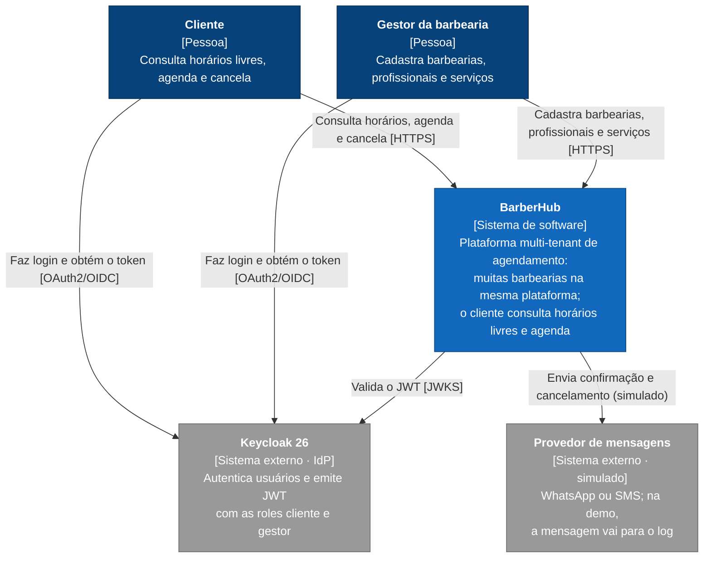
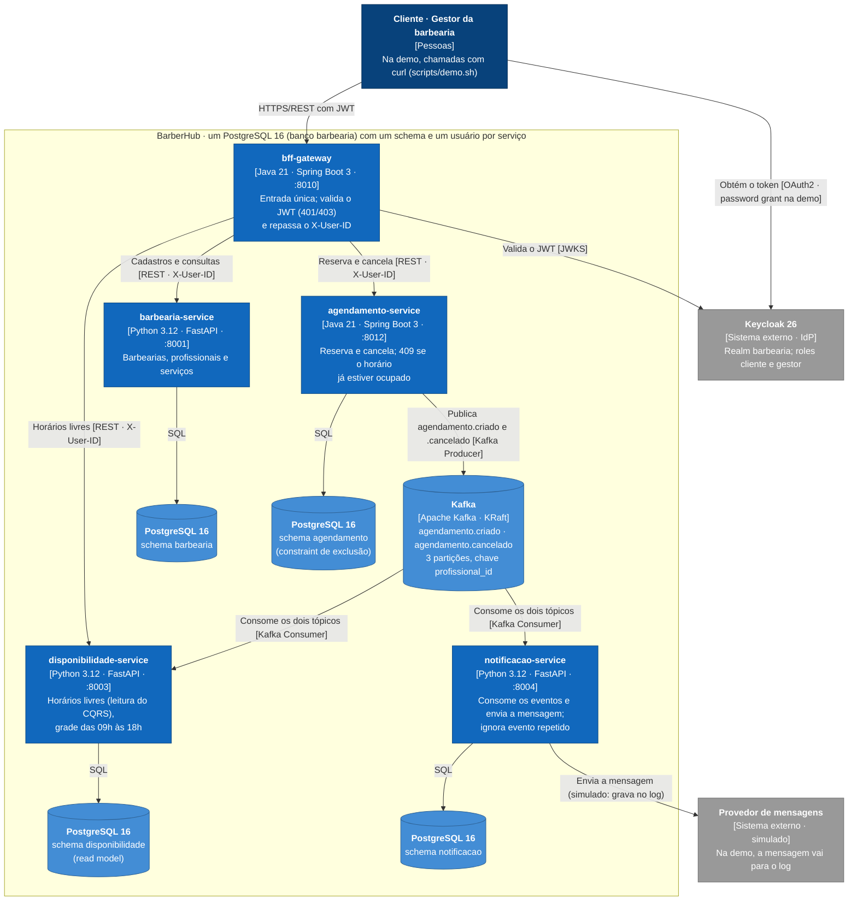

# Arquitetura: C4 do BarberHub

> **Versão do roadmap de 21/10/2026, conferida com o código em 24/10/2026.** Só entra o que existe no código da demo; o contrato completo (portas, rotas, eventos, banco) está em [docs/tarefas.md](../tarefas.md#contrato).

- **Board no Miro (fonte dos diagramas dos slides):** <https://miro.com/app/board/uXjVEdd_Nsc=/>
- **Esta página:** espelho em Mermaid para revisar no GitHub e versionar junto do código. Quem mudar um container, tópico ou seta avisa o Allainn, que atualiza os dois.

**Legenda:** azul-escuro = pessoa · azul = dentro do sistema · cinza = sistema externo.

## Nível 1 · Contexto

## Nível 2 · Containers

## Onde está cada decisão

No Miro, cada elemento tem uma etiqueta verde com link para o ADR. Aqui, a mesma relação:

| Elemento | ADR |
|---|---|
| BarberHub e o volume que justifica a arquitetura | [ADR-0003](../adr/0003-enquadramento-plataforma-multi-tenant.md) |
| Os 5 containers e os 2 tópicos | [ADR-0004](../adr/0004-decomposicao-em-servicos.md) |
| Java nos dois serviços com Spring Boot, Python nos três com FastAPI | [ADR-0005](../adr/0005-linguagens-por-servico.md) |
| REST do BFF para os serviços; Kafka entre o agendamento e os consumers | [ADR-0006](../adr/0006-comunicacao-sincrona-e-kafka.md) |
| Constraint de exclusão e 409 no agendamento | [ADR-0007](../adr/0007-concorrencia-na-reserva-de-horario.md) |
| disponibilidade-service como lado de leitura do CQRS | [ADR-0008](../adr/0008-cqrs-na-consulta-de-disponibilidade.md) |
| Keycloak como provedor de identidade | [ADR-0009](../adr/0009-seguranca-keycloak-e-validacao-jwt.md) |
| Roles cliente e gestor; JWT conferido só no BFF, que repassa o X-User-ID | [ADR-0014](../adr/0014-modelo-de-autorizacao-rbac.md), [ADR-0015](../adr/0015-onde-autenticar-e-autorizar.md) |
| Clean Architecture e DDD no agendamento | [ADR-0010](../adr/0010-arquitetura-interna-dos-servicos.md) |
| Um PostgreSQL com um schema e um usuário por serviço | [ADR-0011](../adr/0011-dados-por-servico.md) |

Fora dos diagramas: o CI/CD e a stack Grafana ([ADR-0013](../adr/0013-entrega-continua-e-observabilidade.md)) e a decisão de não usar Outbox ([ADR-0012](../adr/0012-garantia-de-publicacao-outbox.md)).

## Fluxo da demo

1. Sem token: **401**. Cliente cadastrando serviço: **403**.
2. Cliente consulta os horários livres (BFF → disponibilidade-service).
3. Duas reservas no mesmo horário ao mesmo tempo: **201** para uma, **409** para a outra (constraint de exclusão no agendamento-service).
4. O evento aparece no Kafka UI, a notificação aparece no log e o horário some da consulta.
5. Uma mudança no barbearia-service passa pelo pipeline, a nova versão sobe, `GET /barbearias` mostra a mudança e a latência aparece no Grafana.

## Nível 3

Fora do escopo do roadmap (corte por prazo).
